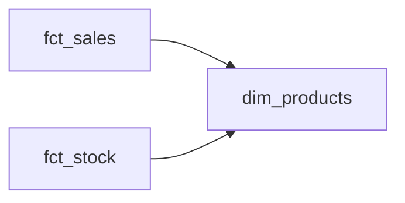

<!-- title: dim_products -->
> This page is generated automatically from the data warehouse documentation (dbt). Changes made here are overwritten: ask the data team to change the text.
{.is-info}

Products "quoted".

## Overview

| | |
|---|---|
| Table in the data warehouse | `marts.dim_products` |

## Connected tables

- Used by **[fct_sales](/team/dm/fct_sales)** (via the link table `bridge_x`)
- Used by **[fct_stock](/team/dm/fct_stock)**

