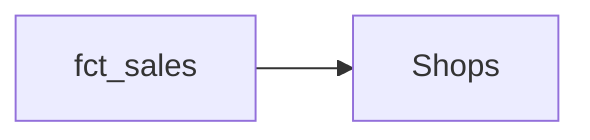

<!-- title: Shops -->
> This page is generated automatically from the data warehouse documentation (dbt). Changes made here are overwritten: ask the data team to change the text.
{.is-info}

Every shop we run. Open or closed.

## Overview

| | |
|---|---|
| Table in the data warehouse | `marts.dim_shops` |

## Connected tables

- Used by **[fct_sales](/team/dm/fct_sales)**

## Columns

| Column | Description | Type | Rules |
|---|---|---|---|
| `shop_id` | Key \| id |  | Unique |
