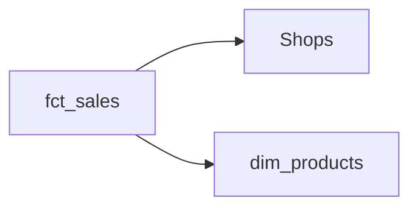

<!-- title: fct_sales -->
> This page is generated automatically from the data warehouse documentation (dbt). Changes made here are overwritten: ask the data team to change the text.
{.is-info}

One row per sale.

## Overview

| | |
|---|---|
| Table in the data warehouse | `marts.sales` |
| Each row is unique by | `shop_id`, `status` |

## Connected tables

- **[Shops](/team/dm/dim_shops)** through `shop_id`
- **[dim_products](/team/dm/dim_products)** through `bridge_id` (via the link table `bridge_x`)

## Columns

| Column | Description | Type | Rules |
|---|---|---|---|
| `SHOP_ID` | The shop. | int | Links to Shops; Always filled |
| `STATUS` | multi line | varchar | One of: open, closed (when shop_id is not null) |
| `AMOUNT` |  | numeric |  |
| `yml_only` | Not in catalog |  |  |
