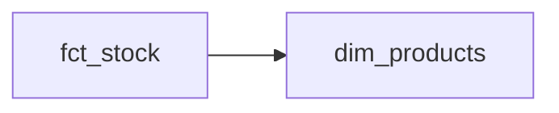

<!-- title: fct_stock -->
> This page is generated automatically from the data warehouse documentation (dbt). Changes made here are overwritten: ask the data team to change the text.
{.is-info}

Stock.

## Overview

| | |
|---|---|
| Table in the data warehouse | `marts.fct_stock` |

## Connected tables

- **[dim_products](/team/dm/dim_products)** through `product_id`

